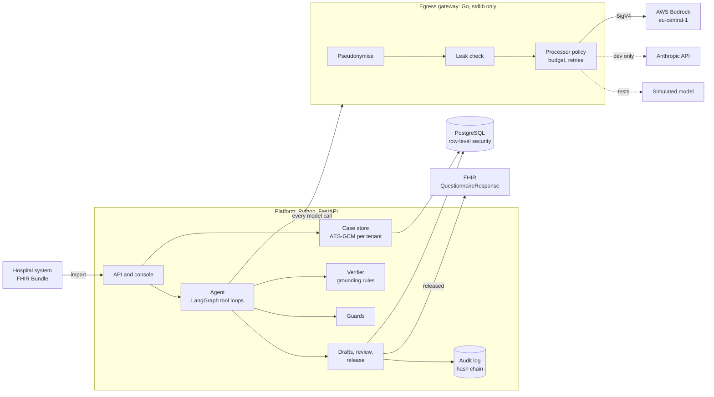

# Design

## The job

A hospital's discharge management (Sozialdienst, ward physicians) has to send a care provider a transfer profile
before a patient can move to short-term care, a nursing home, home care or rehabilitation: what care is needed, how
mobile and oriented the patient is, oxygen, dialysis, catheters, multi-resistant organisms, insurance, legal
representation. The facts are scattered across scanned admission forms, nursing notes, social-services notes, the
discharge letter and dictations. Providers decide on the profile whether to accept the patient.

The agent drafts that profile from the documents. A clinician reviews every field against the source and releases
it. Nothing leaves the hospital as a profile without that release.

## Components

### Egress gateway (`gateway/`)

The only component that can reach a model. It is written in Go with the standard library only, so the code that
decides what leaves the hospital is small, dependency-free and auditable.

- **Identity tokens.** At import the platform seals the case's identity (patient, listed relatives and physicians,
  date of birth, KVNR, case numbers, addresses, phones, e-mails) into an AES-GCM token bound to tenant and case. The
  gateway opens it per request; the platform never sends the identity in clear again.
- **Pseudonymisation with typed tags.** `«Patient»`, `«Angehörige-1»`, `«Arzt-1»`, `«Geburtsdatum, 85 J.»`,
  `«KVNR»`, `«Telefon»`, `«Adresse»`, `«Fallnummer»`, and `«Person-3fa2»` for people the record does not list (a
  keyed hash, stable across documents, not reversible from the tag). The model keeps what it needs (who is the
  patient, how old, which relative) without the identifiers. Ages above 90 are capped.
- **Known identifiers are searched in normalised views** of the text: umlauts and diacritics folded both ways
  (Müller, MUELLER, Muller; Çelik, Celik), Cyrillic transliterated, OCR confusions read in context (O/0, l/1 in a
  number; 0/o in a word), words hyphenated across a line break joined, numbers read as digit runs that include
  dictated digits ("null drei null …"), dictated dates parsed. Surnames that are ordinary words (Stern, Koch, Klein,
  Mai) count only next to a title, role or given name; eponyms (Barthel-Index) stay.
- **People the record does not list** are found from context: titles, relations, sign-offs, a known given name
  followed by a capitalised word, titles in lower-case dictation. Phone numbers, IBANs (checksum), KVNRs (check
  digit), street addresses, case numbers and other ID numbers by pattern.
- **Leak check.** After replacement, a separate check looks for any known identifier without the replacer's context
  rules (word starts inside longer tokens, digit runs as substrings). A request that fails it is refused with the
  kinds found, never the values; a document that fails it at import is blocked from the model and marked in the
  console.
- **Processor policy.** Each tenant lists the processors its data-processing agreement names; hospitals reach
  Bedrock in Frankfurt (SigV4, `eu.` inference profiles), the US API is for development tenants only. Daily token
  budgets, retries with full jitter on 429/529/5xx, Prometheus metrics.

### Platform (`src/cta/`)

- **Import** (`fhir.py`, `cases.py`): a FHIR R4 Bundle (Patient, RelatedPerson, Practitioner, Encounter,
  DocumentReference with text). Originals and pseudonymised text are encrypted with the tenant's key; deleting the
  key or the rows after the retention period crypto-shreds them.
- **Agent** (`agent/`): LangGraph graphs. The drafter loops model ⇄ tools (`list_documents`, `read_document` in
  chunks, `search_documents` with BM25, `record_field`, `mark_unknown`, `record_summary`, `finish`). Context is managed
  by chunked reads and by compacting old document reads once a run passes a number of turns. The chat graph is guard
  → router → answer / draft / providers / refuse. Every model call carries a step budget, a token budget and a
  deadline.
- **Verifier** (`grounding.py`): each recorded value must come with the exact words it was read from. The verifier
  locates the quote (or rejects it), reads the sentence and clause around it, and decides: grounded, contradicted
  (negation before or after, predicate negation at the clause end, removal), unsupported (another person, history,
  plan, proposal, uncertainty), conflict (a later statement says otherwise), injection (the quote is text addressed
  to an AI). Only grounded values are shown as ready; everything else is flagged with the reason and the counter
  evidence.
- **Guards** (`guardrails.py`): instructions to an AI inside documents, questions that ask for a clinical decision
  (refused without a model call), advice in an answer (held back).
- **Drafts and release** (`drafts.py`): each field is accepted, changed, entered or rejected; every action is an
  event (the online evaluation reads them) and an audit entry. Release needs the clinician role and no undecided
  required field, and produces a FHIR QuestionnaireResponse against the profile's Questionnaire.
- **Prompts** (`prompts.py`, `prompts/`): versioned files with a hash; a tenant can run a canary on a stable share
  of cases; the online metrics are split by prompt version and model.
- **Observability** (`observability.py`): OpenTelemetry spans named by the GenAI semantic conventions
  (`invoke_agent`, `chat {model}`, `execute_tool {tool}`, `invoke_workflow`) with `gen_ai.*` attributes, never
  content; Prometheus metrics; JSON logs with an allow-list of keys.

### Simulator (`src/ctasim/`)

There is no access to real patient documents, and no model key in this environment, so the system is exercised
against a simulated world: a generator of German clinical document sets with known facts and traps (facts that
change during the stay, negations, relatives' conditions, history, injected instructions, dictation, OCR damage),
and a simulated model behind the gateway that speaks the Anthropic Messages API, reads only pseudonymised text,
and makes errors at configurable rates that respond to the prompt's instructions. The platform never imports the
simulator; labels reach the evaluation as files.

## Why these choices

- **Models read, code decides.** The model proposes values with quotes; whether a value is shown as grounded is a
  deterministic decision anyone can audit (ADR 0002).
- **Pseudonymise at the egress, not in the prompt.** A prompt cannot promise that identifiers were not sent; a
  gateway that refuses can (ADR 0001).
- **Measure on text the code has not seen.** The deterministic components were run on blind sets before and after
  changes; the first runs are pinned (ADR 0004).
